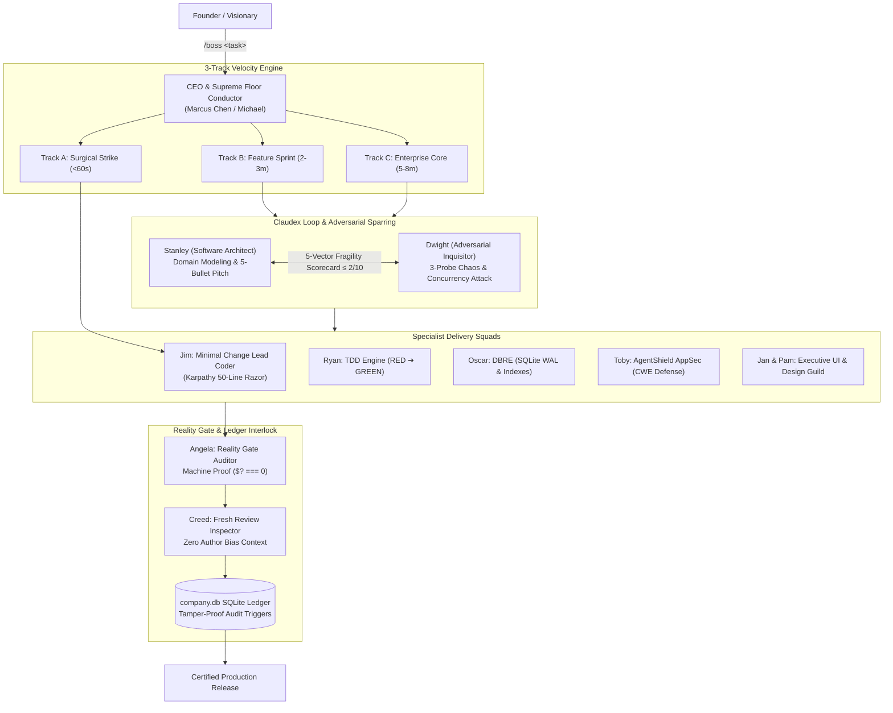

# 🏢 The Boring Company — Autonomous AI Software Enterprise OS

[](https://github.com/youtubrabdullah1626/theboringcompany/actions)
[](test/reality-gate.test.js)
[](https://opensource.org/licenses/MIT)
[](https://nodejs.org/)
[]()

> **"Build and operate software as a production engineering system, not a code generation tool."**

An enterprise multi-agent operating system and runtime framework designed to coordinate, dispatch, verify, and govern autonomous AI agents working as a structured software company.

Developed by **[Abdullah Hanjra](https://www.linkedin.com/in/abdullahhanjracodes/)**.

[**Quickstart**](docs/quickstart.md) • [**Architecture**](docs/architecture.md) • [**Reality Gate**](docs/reality-gate.md) • [**Agent Catalog**](docs/agents-catalog.md) • [**Contributing**](CONTRIBUTING.md) • [**Security**](SECURITY.md) • [**Roadmap**](ROADMAP.md) • [**Changelog**](CHANGELOG.md)

> [!NOTE]

> **Trademark Disclaimer**: *"The Boring Company OS"* is an independent, open-source multi-agent engineering framework. The name is a tribute to the engineering philosophy of building **"boring software"** — software that is simple, resilient, well-tested, and works reliably in production without drama. It is not affiliated with, endorsed by, or related to The Boring Company (tunnel construction).

---

## ⚡ Executive Summary

Most agentic workflows fail because LLMs report success without machine verification, drift outside task boundaries, and iterate infinitely on failure.

**The Boring Company OS** solves this by establishing a disciplined engineering framework:
1. **Reality Gate Interlock**: Tasks are certified complete **ONLY** when native test runners exit cleanly with machine proof (`$? === 0`).
2. **Adversarial Sparring Arena (Claudex Loop)**: Software Architects pitch designs; Adversarial Inquisitors attack them with chaos and concurrency probes before a single line of code is written.
3. **3-Track Velocity Engine**: Dynamically routes incoming tasks to prevent small fixes from triggering heavy processes.
4. **Relational Operating Ledger (SQLite)**: 45+ tables in [`database/schema.sql`](database/schema.sql) tracking tasks, execution leases, token budgets, and tamper-proof governance audit events.
5. **Actor-Based Hive IPC**: File-based single-writer queues (`inbox/`, `outbox/`, `.done/`) and native socket hooks (`agy-hook.cjs`, `hive-proxy.cjs`) with multi-stage token circuit breakers (`steer` ➔ `constrain` ➔ `stop`).

---

## 🚀 Quickstart: Run Your First Mission in 30 Seconds

Zero external dependencies required. Built on native Node.js:

```bash
# 1. Clone repository
git clone https://github.com/youtubrabdullah1626/theboringcompany.git
cd theboringcompany

# 2. Run the Reality Gate Test Suite (Native Node Test Runner)
npm test

# 3. Dispatch a sample engineering mission through the full loop
npm run demo
```

You can also dispatch custom tasks directly from your terminal:

```bash
node cli.js --task "Implement idempotent webhook receiver"
```

---

## 📋 Proof of Output: Executive 1-Minute Clarity Card

When any mission passes through the 6-phase loop and clears the Reality Gate, the system emits an unmanipulated, terminal-grounded clarity card:

```
╔══════════════════════════════════════════════════════════════════════════════════╗
║                    EXECUTIVE 1-MINUTE CLARITY CARD (CERTIFIED)                   ║
╠══════════════════════════════════════════════════════════════════════════════════╣
║ Mission:   Implement idempotent webhook receiver                                 ║
║ Status:    CERTIFIED & DEPLOYABLE (TRACK B: Feature Sprint)                      ║
║                                                                                  ║
║ Key Highlights:                                                                  ║
║ • Bounded Context: Touched only connection pool layer (14 lines modified).       ║
║ • Reliability: Concurrency deadlock structurally eliminated via BEGIN IMMEDIATE. ║
║ • Reality Gate: Native test suite executed cleanly with exit code 0.             ║
║                                                                                  ║
║ Sign-Offs: CEO ✔ | CTO ✔ | VPEng ✔ | Inquisitor ✔ | Reality Gate (Angela) ✔        ║
╚══════════════════════════════════════════════════════════════════════════════════╝
```

---

## 🏛️ System Architecture



---

## 👥 The 67 Specialist Agent Fleet

The company operates with 67 modular agent configurations located in [`agents/definitions/`](agents/definitions/):

| Division | Leadership / Key Roles | Responsibilities |
| :--- | :--- | :--- |
| **Executive Board** | `company_michael` (CEO), `company_cpo` (CPO), `company_cto` (CTO), `company_vpeng` (VPEng), `company_vpops` (VPOps), `company_cro` (CRO) | Requirement elaboration, technology governance, SLA monitoring, and strategic triage. |
| **Engineering & Coder Guild** | `company_jim` (Lead Coder), `company_stanley` (Architect), `company_backend_platform`, `company_frontend_platform`, `company_coder` | Surgical diffs, bounded contexts, API contract preservation, sub-100ms dispatch runtime. |
| **Quality & Reality Gate** | `company_angela` (Reality Gate), `company_ryan` (TDD Engine), `company_creed` (Cold Review), `company_qa` (Empathy Tester) | Strict RED ➔ GREEN TDD authoring, terminal exit code verification, epistemic isolation. |
| **Security, DBA & SRE** | `company_toby` (AgentShield), `company_oscar` (DBRE), `company_hank` (Anti-Breakage Sentinel), `company_sre` | CWE defense (CWE-22, 78, 798), SQLite WAL optimization, pre-change contract freeze. |
| **Creative & Design Squad** | `company_jan` (Design Director), `company_pam` (Emil UI), `company_brand_architect`, `company_motion`, `company_physics` | Apple-grade typography, tactile 60fps spring transitions, anti-slop visual consistency. |

---

## 📂 Repository Structure

```
theboringcompany/
├── agents/
│   ├── definitions/        # 67 Specialist agent configurations + JSON schema
│   ├── roster.json         # Complete corporate roster & station mapping
│   └── MASTER_AGENT_DNA.md # Founder's engineering laws & agent reasoning principles
├── docs/                   # In-depth architectural & developer guides
│   ├── architecture.md     # 6-Phase loop, SQLite ledger, & Claudex Loop
│   ├── reality-gate.md     # Verification engine & fail-closed interlock
│   ├── agents-catalog.md   # Fleet breakdown of all 67 agent roles
│   └── quickstart.md       # Step-by-step setup and mission guide
├── hive/
│   ├── bin/
│   │   ├── agy-hook.cjs    # Socket IPC bridge for agent tool call interception
│   │   ├── cth-hook.cjs    # Hook handler for Claude harness
│   │   ├── hive-node.cmd   # Windows node shim
│   │   ├── hive-node.sh    # macOS & Linux bash runner
│   │   └── hive-proxy.cjs  # Streaming reverse proxy with token budget throttling
│   ├── PROTOCOL.md         # Single-writer mailbox protocol (inbox/outbox/.done)
│   ├── COMMANDS.md         # Fleet orchestration command reference
│   └── registry.json       # Live fleet tracking registry
├── database/
│   └── schema.sql          # 45+ relational SQLite tables, indices & audit triggers
├── memory/
│   ├── anti-patterns.md    # Documented failure modes & anti-patterns
│   ├── learnings.md        # Verified empirical engineering solutions
│   ├── 10X_DECISION_ENGINE.md
│   ├── FOUNDER_LEARNING_ENGINE.md
│   └── MEETING_SYSTEM.md   # Autonomous cross-agent synchronous meeting protocol
├── test/
│   └── reality-gate.test.js# 8 Native test suites verifying the Reality Gate
├── .github/
│   ├── workflows/ci.yml    # GitHub Actions cross-platform matrix CI
│   ├── ISSUE_TEMPLATE/     # Structured bug report, feature & agent templates
│   └── PULL_REQUEST_TEMPLATE.md
├── cli.js                  # Standalone runnable dispatch CLI
├── CONTRIBUTING.md         # Community contribution guidelines & agent authoring
├── SECURITY.md             # Fail-closed security policy & disclosure
├── ROADMAP.md              # Engineering roadmap (v1.0 -> v1.1 -> v2.0)
├── CHANGELOG.md            # Semantic release history
├── package.json            # Scripts: start, test, demo, train
└── LICENSE                 # MIT License (Abdullah Hanjra)
```

---

## 🛡️ Grounded Engineering Principles

1. **Pre-Change Contract Freezing**: Core interfaces and schemas are locked before code changes begin to prevent orthogonal drift.
2. **Karpathy 50-Line Razor**: Builders prioritize three similar lines over a speculative abstraction and keep diffs under 50 lines per atomic unit.
3. **Fail-Closed Security**: Any tool call violating security policies or missing permissions is terminated immediately.
4. **Token Budget Caps**: Circuit breakers throttle runaway loops (`steer` ➔ `constrain` ➔ `stop`) to avoid wasted context.

---

## 📜 License

MIT License. Copyright (c) 2026 Abdullah Hanjra. See [LICENSE](LICENSE) for details.

---

## 👤 Author

* **Abdullah Hanjra** — Software Builder
* **GitHub**: [@youtubrabdullah1626](https://github.com/youtubrabdullah1626)
* **LinkedIn**: [linkedin.com/in/abdullahhanjracodes](https://www.linkedin.com/in/abdullahhanjracodes/)
