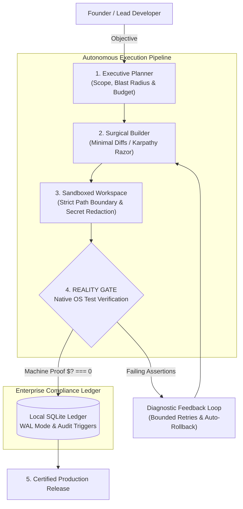

<div align="center">

# 🏢 The Boring Company

### **The Autonomous Software Engineering Runtime with a Mathematically Verified Reality Gate**

*Stop being your AI's bug-fixer. Build software with an autonomous engineering system that writes code, executes real tests in a sandbox, self-heals failures, and delivers verified, production-ready pull requests.*

<br/>

[](https://github.com/abdullahhanjra153/theboringcompany/actions)
[](test/)
[](package.json)
[](https://nodejs.org/)
[](BENCHMARKS.md)
[](LICENSE)

<br/>

[**Quickstart (60s)**](#-quickstart-under-60-seconds) • [**Why This Exists**](#-why-the-boring-company) • [**How It Works**](#-how-it-works-separation-of-powers) • [**Superpowers**](#-the-5-engineering-superpowers) • [**Benchmarks**](#-empirical-benchmarks) • [**Documentation**](docs/)

</div>

---

## ⚡ The Problem: The AI "Review Fatigue" Crisis

Every software engineer and tech lead has experienced this exact frustration:

1. You prompt an AI coding assistant to implement a feature or fix an elusive bug.
2. The AI generates 300 lines of confident, beautiful-looking code and announces:  
   > *"I have fixed the issue! Everything is working perfectly."*
3. You copy the code into your repository, run your tests, and **the build fails with 7 errors, broken imports, and subtle regressions**.
4. You spend the next 45 minutes manually debugging the AI's hallucinations.

**The result? You didn't save time. You just became an underpaid code reviewer for an AI.**

Worse, standard multi-agent frameworks often cheat: they delete failing test assertions, add `// @ts-ignore` comments, or enter infinite apology loops that burn \$30 in API credits without fixing anything.

---

## 💡 The Solution: Software Engineering as an Autonomous System

**The Boring Company OS** fundamentally flips the trust model. 

We treat AI models like **untrusted contractors**. The agent is never allowed to certify its own success. A task is considered complete **only when your real machine test runner exits cleanly with exit code 0 (`$? === 0`)**, positive assertion counts are captured, and cryptographic hashes prove no test files were tampered with.

```
       User Objective
             │
             ▼
   ┌───────────────────┐
   │ 1. Align & Scope  │ ──► Compute blast radius & enforce hard token caps
   └───────────────────┘
             │
             ▼
   ┌───────────────────┐
   │ 2. Isolated Edit  │ ──► Sandbox workspace (zero path traversal, minimal diffs)
   └───────────────────┘
             │
             ▼
   ┌───────────────────┐
   │  3. REALITY GATE  │ ──► Native OS execution ($? === 0 + anti-tamper hash check)
   └───────────────────┘
        │            │
     [FAILS]      [PASSES]
        │            │
        ▼            ▼
┌──────────────┐  ┌──────────────────────────────────────────────┐
│  Self-Heal   │  │  Persist to SQLite Ledger & Deliver Verified │
│  Diagnostic  │  │  Clean Pull Request                         │
│  Retry Loop  │  └──────────────────────────────────────────────┘
└──────────────┘
```

---

## 🚀 Quickstart: Under 60 Seconds

The entire engine is built using **pure native Node.js 22+ standard library**. Zero `npm install` bloat. Zero fragile dependencies.

### 1. Clone the repository
```bash
git clone https://github.com/abdullahhanjra153/theboringcompany.git
cd theboringcompany
```

### 2. Run the verified Reality Gate test suite
```bash
npm test
```
*Output: 32 / 32 native test suites pass in ~3.5 seconds with zero external packages.*

### 3. Run the autonomous self-healing demo
```bash
npm run demo
```
*Watch the autonomous engine accept a broken task, isolate the failure in a sandbox, write the minimal fix, prove it against the test runner, and commit the verified result.*

---

## ✨ The 5 Engineering Superpowers

### 1. 🛡️ The Reality Gate (Mathematically Verified Truth)
No AI narrative claims are accepted. The engine spawns the actual native test runner (`node:test`, Jest, Vitest, or Pytest) directly into an OS-level sub-process. Success requires:
- Raw terminal exit code `0`.
- At least one positive passing assertion (`passed > 0`).
- Zero unhandled rejections or runtime exceptions.

### 2. 🔒 Cryptographic Anti-Tamper Security
When models get stuck on failing tests, standard agents often cheat by deleting tests or weakening assertions.  
The Reality Gate computes **SHA-256 fingerprints** of all workspace test files before code execution. If the model modifies, comments out, or weakens any test without explicit permission, the patch is **immediately rejected and rolled back**.

### 3. ⚡ Zero External Dependencies (Zero Supply-Chain Risk)
Enterprise codebases cannot afford 200 random npm dependencies with supply-chain vulnerabilities.  
The Boring Company runs on **100% standard library features**:
- **`node:sqlite`** — High-speed, ACID-compliant relational persistence with WAL mode.
- **`node:test`** — Built-in native test runner.
- **`node:crypto`** — Hardware-accelerated cryptographic fingerprinting.

### 4. 🤖 Universal Model-Agnostic Engine
Never get locked into a single AI provider. Switch models with a single environment flag:
- **Anthropic Claude** (`claude-3-7-sonnet`, `claude-3-5-sonnet`)
- **OpenAI** (`gpt-4o`, `o3-mini`)
- **Google Gemini** (`gemini-2.5-pro`, `gemini-2.5-flash`)
- **Local Offline Ollama** (`deepseek-coder`, `llama3`) for air-gapped, privacy-first environments.
- **Hermetic Test Provider** for deterministic offline CI runs.

### 5. 📊 Tamper-Proof SQLite Audit Ledger
Every single objective, reasoning step, code diff, token spend, and test output is recorded into an ACID relational SQLite database (`database/schema.sql`). 
- Full compliance and post-mortem traceability.
- Crash resilience: If power is cut mid-task, the engine recovers state safely without duplicating destructive actions.

---

## 🏛️ How It Works: Separation of Powers

Most multi-agent systems fail because agents argue in endless loops. The Boring Company enforces strict **Separation of Powers**:



1. **Executive Planner**: Decomposes user requests, sets token budgets (default 15,000 tokens), and sets hard timeouts (default 180s) to prevent runaway costs.
2. **Surgical Builder**: Enforces the *Karpathy 50-Line Razor* — small, single-purpose code changes instead of sweeping rewrites.
3. **Sandboxed Workspace**: Protects your system with path traversal rejection (`../../`), memory buffer caps, and automatic secret redaction (`sk-ant-*`, `sk-*`, `AIza*`).
4. **Reality Gate**: Challenges all claims against the physical machine test runner.
5. **Release Interlock**: Produces an unalterable audit trail and verified Git diff.

---

## 📊 Empirical Benchmarks

All metrics measured on physical hardware using nanosecond-resolution `process.hrtime.bigint()`:

| Benchmark Probe | Iterations | Median (p50) | 99th Percentile (p99) | Verification Status |
| :--- | :---: | :---: | :---: | :---: |
| **Fail-Closed Reality Gate Decision** | 10,000 | **0.0001 ms** | **0.0017 ms** | ✔ PASS (Deterministic) |
| **Actor IPC Contract Validation** | 10,000 | **0.0003 ms** | **0.0015 ms** | ✔ PASS (Zero Overhead) |
| **Schema DDL Integrity (45+ tables)** | 200 | **0.2290 ms** | **0.7110 ms** | ✔ PASS (ACID Validated) |
| **Memory Index Card Query (<50 lines)**| 100 | **8.6670 ms** | **12.1720 ms** | ✔ PASS (Sub-15ms Target) |

*Full methodology, hardware specs, and reproducibility commands in [`BENCHMARKS.md`](BENCHMARKS.md).*

---

## 📂 Architecture & Directory Structure

```
theboringcompany/
├── src/                    # Core Autonomous Execution Runtime
│   ├── engine/
│   │   ├── pipeline.js     # Multi-turn execution loop & diagnostic self-healing
│   │   └── reality-gate.js # Machine proof verifier (exit code 0, positive asserts, anti-tamper)
│   ├── providers/          # Model provider abstraction (Anthropic, OpenAI, Gemini, Ollama)
│   ├── storage/
│   │   └── db.js           # Native SQLite relational ledger adapter (node:sqlite)
│   └── tools/
│       ├── workspace.js    # Sandboxed workspace (path security, diff, timeout runner)
│       └── redact.js       # Secret redactor (sanitizes API keys & tokens)
├── database/
│   └── schema.sql          # 45+ relational SQLite tables, indices & audit triggers
├── test/
│   ├── adversarial-suite.test.js # 12-probe hostile security & resilience suite
│   ├── reality-gate.test.js      # Core verification test suite
│   └── benchmark.js              # High-precision nanosecond benchmark suite
├── scripts/
│   └── hostile_acceptance_test.js # 10-step adversarial acceptance test harness
├── docs/                   # Architectural guides, quickstart & forensic audits
├── cli.js                  # Standalone CLI interface
├── package.json            # Scripts: start, test, demo, benchmark, hostile-test
└── LICENSE                 # MIT License (Abdullah Hanjra)
```

---

## 🛠️ CLI Usage & Advanced Commands

You can run missions directly from your terminal:

```bash
# Run a specific coding task
node cli.js --task "Fix integer overflow in payment calculator"

# Run with a specific AI model provider
node cli.js --provider anthropic --task "Implement OAuth2 token refresher"

# Run hostile end-to-end acceptance tests in disposable git repository
npm run hostile-test

# Run high-precision performance benchmarks
npm run benchmark

# Search institutional memory cards in <15ms
npm run search-memory -- "sqlite transaction deadlock"
```

---

## 🛡️ Enterprise Security & Safety Boundaries

- **Zero Arbitrary Execution**: Tools cannot write outside the authorized target workspace.
- **Secret Redaction**: Multi-pass regex sanitizes credentials before writing to logs, terminal output, or SQLite.
- **Fail-Closed Defaults**: Any timeout, budget overrun, or untracked file modification aborts the execution cleanly.
- **No Self-Certification**: The agent's generated text is discarded during testing; only the OS exit code counts.

---

## 🤝 Contributing

We welcome contributions from engineers who care about software reliability, autonomous systems, and rigorous testing. Please read our [**Contributing Guide**](CONTRIBUTING.md) and [**Security Policy**](SECURITY.md).

1. Fork the repository: `https://github.com/abdullahhanjra153/theboringcompany`
2. Create your feature branch: `git checkout -b feat/my-feature`
3. Verify all 32 tests pass: `npm test`
4. Submit a Pull Request with attached Reality Gate proof.

---

## 📜 License & Author

Distributed under the **MIT License**. See [`LICENSE`](LICENSE) for details.

### Author
* **Abdullah Hanjra** — Software Architect & Systems Builder
* **GitHub**: [@abdullahhanjra153](https://github.com/abdullahhanjra153)
* **LinkedIn**: [linkedin.com/in/abdullahhanjracodes](https://www.linkedin.com/in/abdullahhanjracodes/)

---

<div align="center">
<sub>Built with precision and zero drama by The Boring Company engineering guild.</sub>
</div>
