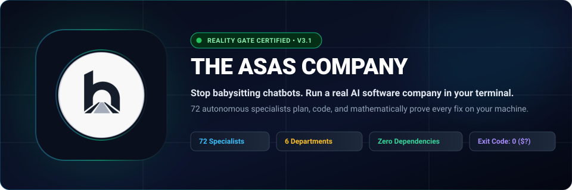
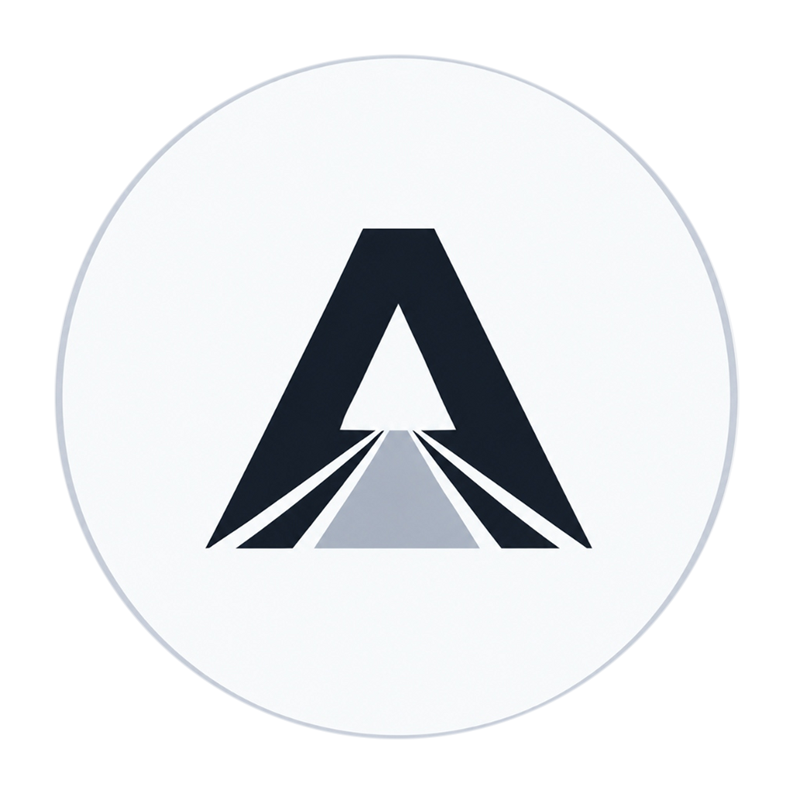

<div align="center">

<a href="https://github.com/abdullahhanjra/theasascompany">
  
</a>

<br/><br/>

<a href="https://github.com/abdullahhanjra/theasascompany">
  
</a>

# The Asas Company

**Your terminal. Your company. 72 AI specialists who actually prove their work.**

*Pure Node.js · Zero dependencies · 100% private · Tests must pass or it doesn't ship*

<br/>

[](https://github.com/abdullahhanjra/theasascompany/actions)
[](test/)
[](#departments)
[](package.json)
[](#board-meeting)
[](https://nodejs.org/)
[](LICENSE)

<br/>

[**Quickstart**](#quickstart) · [**Demo**](#demo) · [**Board Meeting**](#board-meeting) · [**Org Chart**](#org-chart) · [**Departments**](#departments) · [**Reality Gate**](#reality-gate) · [**Comparison**](#comparison)

</div>

---

## The Problem

You ask an AI to fix a bug. It rewrites 300 lines, says *"done!"*, and your app crashes.

You paste it in again. Same promise. Same crash. You spend the next hour cleaning up the mess.

That's not a coding assistant — that's an overconfident intern with no supervision, no tests, and no accountability.

---

## What This Is

**The Asas Company** gives you a full software engineering firm that runs inside your terminal.

You're the Founder. You give a goal in plain English. Your team of 72 specialists across 6 departments plans, builds, security-checks, and physically runs your tests on your machine — until the exit code is 0.

```
                            YOU (THE FOUNDER)
                                   │
                                   ▼
 ┌─────────────────────────────────────────────────────────────────────────┐
 │ 1. EXECUTIVE BOARD (Michael Scott, Marcus Chen, Stanley Hudson)         │
 │    Convenes in 37ms. Scopes the work, picks the track, sets the plan.  │
 └────────────────────────────┬────────────────────────────────────────────┘
                              │
                              ▼
 ┌─────────────────────────────────────────────────────────────────────────┐
 │ 2. RED TEAM & SECURITY (Dwight Schrute & Toby Flenderson)               │
 │    "What if they double-click? What if the network drops?"              │
 └────────────────────────────┬────────────────────────────────────────────┘
                              │
                              ▼
 ┌─────────────────────────────────────────────────────────────────────────┐
 │ 3. CORE ENGINEERING (Jim Halpert & Oscar Martinez)                      │
 │    Writes a focused patch. Under 50 lines. Doesn't touch anything else. │
 └────────────────────────────┬────────────────────────────────────────────┘
                              │
                              ▼
 ┌─────────────────────────────────────────────────────────────────────────┐
 │ 4. THE REALITY GATE (Angela Martin — Head of QA)                        │
 │    Runs `npm test` on your machine. Exit code must be 0. No exceptions. │
 └───────────────────────┬─────────────────────┬───────────────────────────┘
                         │                     │
                  [Tests Fail ❌]        [Tests Pass ✅]
             Jim fixes the exact error.    Angela certifies.
             Never touches dirty state.    Saved to company.db and shipped.
```

---

<a id="demo"></a>
## See It in Action

```bash
boss "Fix checkout: if someone clicks Pay twice quickly, it charges them twice"
```

Here's what actually happens:

- 👔 **Michael Scott (CEO):** *"Team, customer is getting charged twice on fast double-clicks. Marcus, break it down."*

- 📋 **Marcus Chen (CPO):** *"Three steps: disable the button after first click, add a unique receipt ID per order, and reject duplicates server-side."*

- 🥊 **Dwight Schrute (Red Team):** *"What if they refresh mid-payment? What if the phone auto-retries? Button-only protection won't hold — we need database-level idempotency."*

- 📐 **Stanley Hudson (CTO):** *"Correct. Jim, write a tight patch blocking duplicates at the database. Under 50 lines. Oscar, verify the index."*

- 💻 **Jim Halpert (Lead Coder):** *"Done — 14 clean lines added to `checkout.js`. Nothing else touched."*

- 🧮 **Oscar Martinez (DBA):** *"Unique receipt ID bounces any duplicate in under a millisecond. Zero slowdown."*

- 🔒 **Toby Flenderson (Security):** *"Scanned the diff. No leaked keys, no injection points. Clean."*

- 🧪 **Angela Martin (QA):** *"Nobody celebrates until the machine says so. Running now... `npm test` exited with code 0. All 97 tests pass across 6 suites. Certified."*

- 📦 **Darryl Philbin (Operations):** *"Logged to `company.db`. Ready to ship."*

---

<a id="board-meeting"></a>
## The Autonomous Board Meeting

Before touching a single file, call a board meeting. Seven department heads deliberate the architecture, debate trade-offs, and produce an ordered sprint plan — in **~37 milliseconds at 0 API tokens**.

```bash
boss meet "Should we use PostgreSQL or SQLite for storing user sessions?"
```

```
══════════════════════════════════════════════════════════════════════════════
🏛️  THE ASAS COMPANY — EXECUTIVE COUNCIL CHAMBERS
Session: "Should we use PostgreSQL or SQLite for storing user sessions?"
Consensus: UNANIMOUS (MOTION PASSED) | Track: B (Feature Sprint) | 37ms
══════════════════════════════════════════════════════════════════════════════

  [Michael Scott - CEO]
  ↳ Council, we need to decide where user sessions live. Marcus, what matters?

  [Marcus Chen - CPO]
  ↳ Speed. Sessions should load in under 5ms. No complex cloud setup right now.

  [Rafael Torres - CTO]
  ↳ SQLite on local disk — zero network latency, zero hosting cost.

  [Dwight Schrute - Red Team]
  ↳ What if 100 users log in at the same second? Does SQLite freeze?

  [Dr. Kofi Mensah - DBA]
  ↳ In WAL mode, SQLite handles concurrent reads and writes simultaneously.
    Easily exceeds 50,000 writes per second in benchmarks.

  [Angela Martin - QA Gate]
  ↳ I want automated stress tests before anyone writes production code.

  [Michael Scott - CEO]
  ↳ Motion approved: SQLite with WAL mode, plus Angela's stress test suite.

📋 Sprint Backlog:
  • [Step 1] Create sessions table with WAL settings (Dr. Kofi)
  • [Step 2] Write 100-concurrent-user stress tests (Dwight & Ryan)
  • [Step 3] Session manager, under 50 lines (Jim Halpert)
  • [Step 4] Run real tests until exit code 0 (Angela Martin)

✔ Minutes saved: docs/meetings/MEETING_2026-10-24_sessions.md
✔ Decision logged: docs/DECISION_LOG.md
══════════════════════════════════════════════════════════════════════════════
```

> Add `--interactive` to join the meeting, vote on decisions, and cast the Founder tie-breaker.

---

<a id="org-chart"></a>
## The Org Chart

```
                            ┌─────────────────────────┐
                            │      YOU (FOUNDER)      │
                            └────────────┬────────────┘
                                         │
                                         ▼
                            ┌─────────────────────────┐
                            │  MICHAEL SCOTT (CEO)    │
                            │   Supreme Conductor     │
                            └──────┬──────────┬───────┘
                                   │          │
       ┌───────────────────────────┘          └───────────────────────────┐
       ▼                                                                  ▼
┌──────────────────────────┐                           ┌──────────────────────────────┐
│  INDEPENDENT QA BRANCH   │                           │    EXECUTIVE DIRECTORS       │
│  Angela Martin (QA Lead) │                           │  Stanley (CTO) · Marcus (CPO)│
│  Reports to Founder.     │                           │  David (VP Eng) · Darryl (Ops│
│  Coders cannot overrule. │                           │  Jan (CRO & Brand)           │
└────────────┬─────────────┘                           └──────────────┬───────────────┘
             │                                                         │
             │              ┌──────────────────────────────────────────┤
             ▼              ▼                    ▼                     ▼
┌────────────────────┐  ┌────────────────────┐  ┌─────────────────────┐  ┌──────────────────────┐
│  REALITY GATE SQUAD│  │  RED TEAM & SEC    │  │  CORE ENGINEERING   │  │  PRODUCT & DESIGN    │
│  (Under Angela)    │  │  (Dwight & Stanley)│  │  (Under David)      │  │  (Marcus & Jan)      │
│  Ryan (TDD Writer) │  │  Dwight (Red Lead) │  │  Jim (Min. Coder)   │  │  Pam (UI Designer)   │
│  Kevin (DoD Check) │  │  Toby (Security)   │  │  Oscar (DBA)        │  │  Val (Accessibility) │
│  Isabela (E2E)     │  │  Creed (Fresh-Eye) │  │  Andy (API Builder) │  │  Zara (UX Lead)      │
│  Erin (User Tests) │  └────────────────────┘  │  Nate (Performance) │  │  Elena (Design Tokens│
└────────────────────┘                           │  +45 specialists    │  └──────────────────────┘
                                                 └──────────┬──────────┘
                                                            │
                                                            ▼
                                                 ┌──────────────────────┐
                                                 │  OPERATIONS SQUAD    │
                                                 │  (Under Darryl)      │
                                                 │  Hank (File Guard)   │
                                                 │  Phyllis (Memory)    │
                                                 │  Amira (Uptime)      │
                                                 └──────────────────────┘
```

### Chain of Command

**You (Founder)** → Give one goal in plain English. That's it.

**Michael Scott (CEO)** → Runs the standup, picks the specialists, owns delivery.

**Marcus Chen (CPO)** → Turns your short prompt into clear requirements and edge cases before any code is written.

**Stanley Hudson (CTO)** → Keeps code minimal. If 15 lines solves it, he rejects 500.

**David Wallace (VP Engineering)** → Manages file leases so nobody overwrites each other's work.

**Jan Levinson (CRO & Brand)** → Checks that what gets built makes sense for real users.

**Darryl Philbin (VP Operations)** → Watches token spend in real time. Pulls the brake if anything runs away.

**Angela Martin (Head of QA)** — Independent branch. She doesn't report to Engineering. Coders can't overrule her. Code only ships when your machine's tests pass with exit code 0.

---

<a id="protocols"></a>
## How 72 Specialists Work Together

### File Leases (No Overwritten Work)
When a task starts, Michael runs an instant standup and issues exclusive leases in `company.db`. Only the assigned specialist can edit the target files. Everyone else reads. Zero merge conflicts.

### Department Mailboxes
Each squad has its own inbox:
- `tasks/inbox/` — Marcus posts the spec
- `tasks/review/` — Dwight and Toby check for edge cases and vulnerabilities
- `tasks/verification/` — Jim's diff goes to Angela for machine testing
- `tasks/done/` — Angela records the verified test output

### 3 Quality Gates
No code ships because someone said it works. It passes three gates:

1. **Design Gate** — Marcus scopes requirements. Dwight stress-tests edge cases. Stanley locks the simplest design.
2. **Code & Security Gate** — Jim writes the patch (≤ 50 lines). Toby scans for leaks and injection. Oscar checks database indexes.
3. **Machine Gate** — Angela runs `npm test` (or `pytest`, `cargo test`). Exit code must be 0. If not, Jim gets the exact error and fixes it. No exceptions.

### Local Ledger (`company.db`)
Every decision, code diff, and test run is saved to a local SQLite database on your machine. Close the terminal. Shut down the computer. It's still there. 100% offline, 100% yours.

### Safety Brakes
Darryl watches resource usage live:
- At 75% budget — coders switch to the smallest possible fix
- At 90% budget — exploratory changes stop, focus shifts to passing tests
- At 100% — the task safely pauses, rolls back to last clean Git snapshot, and reports what happened

---

<a id="departments"></a>
## The 6 Departments

### Executive Board & Strategy
*Scopes the work, sets the plan, keeps everyone aligned.*

**Michael Scott (CEO)** — When you type `boss "fix checkout"`, Michael runs the standup, picks the right specialists, and stays on it until the tests pass.

**Marcus Chen (CPO)** — Turns your two-word prompt into real requirements: what the feature does, what edge cases to handle, and what "done" means.

**Stanley Hudson (CTO)** — Hates bloated code. Rejects 500 lines of new framework when 15 lines of JavaScript will do it.

**David Wallace (VP Engineering)** — Coordinates the coders, manages file leases, keeps diffs clean.

**Jan Levinson (CRO & Brand)** — Checks that what gets built makes sense for real users and looks polished.

**Darryl Philbin (VP Operations)** — Tracks token costs live, monitors database health, and pulls the emergency brake if anything loops.

---

### Red Team & Security
*Catches bugs and security holes before anyone writes code.*

**Dwight Schrute (Red Team Lead)** — The resident skeptic. "What if they double-click? What if the network drops? What if the database is busy?" He catches edge cases during planning — before they become production incidents.

**Toby Flenderson (Security)** — Scans every diff for leaked API keys, hardcoded passwords, SQL injection, and unsafe file paths. Quiet, thorough, and never skipped.

**Creed Bratton (Fresh-Eye Reviewer)** — After hours on a problem, engineers get blind to their own bugs. Creed reads diffs cold, with no context, and catches what everyone else missed.

---

### Core Engineering & Database
*Writes small, focused patches and keeps your database fast.*

**Jim Halpert (Lead Minimalist Coder)** — Enforces The Asas Razor and the 50-line rule: *the best code is the code you never wrote.* He greps callers first, reuses existing code, deletes bloat, leaves a test for risky logic, and touches nothing else.

**Oscar Martinez (Database Engineer)** — Crafts fast SQLite and PostgreSQL schemas, verifies indexes, and makes sure migrations run clean without corrupting data.

**Andy Bernard (API Builder)** — Designs predictable REST endpoints with correct status codes, helpful error messages, and proper input validation.

**Nate (Performance)** — Profiles memory, eliminates redundant loops, and optimizes slow queries so the app stays snappy.

---

### Quality Assurance & Reality Gate
*Demands machine proof. Rejects AI promises.*

**Angela Martin (Head of QA)** — The most important person in the company. She runs your computer's real test command. If there's even one failure, she blocks the release. No coder can override her.

**Ryan Howard (TDD Writer)** — Writes the failing test first. The bug doesn't get fixed until that test turns green.

**Kevin Malone (DoD Auditor)** — Walks through Marcus's original requirements checklist item by item. If one thing is missing, he sends it back.

**Erin Hannon (User Empathy Tester)** — Tests your app like a first-time user. Enters unexpected inputs, clicks things out of order, and checks that error messages are actually helpful.

---

### Product Design & UX
*Makes sure your product looks good and works for everyone.*

**Pam Beesly (UI Designer)** — Clean typography, balanced spacing, smooth interactions. Replaces generic AI layouts with something that actually looks handcrafted.

**Val Johnson (Accessibility)** — Audits contrast ratios, keyboard navigation, and screen-reader support. Makes sure your app works for everyone.

**Zara (UX Lead)** — Focuses on user workflows, edge-case user states, and making sure the product actually makes sense to use.

**Elena (Design Tokens)** — Keeps buttons, colors, and typography consistent across the whole app so it looks like one product, not five different ones.

---

### Operations, Systems & Release
*Protects your files, manages releases, and builds team memory.*

**Darryl Philbin (Release & Packaging)** — Handles semantic versioning, writes changelogs, and verifies zero dependencies are broken before a release.

**Hank Tate (Workspace Guard)** — Makes sure agents only touch files inside your project directory. Never your system files.

**Phyllis Vance (Institutional Memory)** — When a tricky bug gets solved, she logs the learning into `company.db`. Next time a similar problem comes up, the team solves it faster.

**+ 45 Domain Specialists** — Mobile, Docker, WebSockets, documentation, and more. Run `node scripts/install-tools.js --list` to see the full roster.

---

<a id="reality-gate"></a>
## The Reality Gate

Every other AI tool uses narrative confirmation — the AI *says* it works, so the tool marks it done.

The Asas Company uses a physical interlock:

```
                   ┌─────────────────────────────────┐
                   │        AI Generates Code        │
                   └────────────────┬────────────────┘
                                    │
                                    ▼
                   ┌─────────────────────────────────┐
                   │      THE REALITY GATE VAULT     │
                   │    (Under Angela Martin — QA)   │
                   └────────────────┬────────────────┘
                                    │
     ┌──────────────────────────────┼──────────────────────────────┐
     ▼                              ▼                              ▼
[Exit Code Check]         [Anti-Tamper Guard]            [Assertion Audit]
Did `npm test` exit 0?    Did the AI touch or delete     Did real assertions run,
Exit 1 = REJECTED.        test files? Caught = REJECTED.  or was it empty? 0 = REJECTED.
     └──────────────────────────────┼──────────────────────────────┘
                                    │
                                    ▼
                   ┌─────────────────────────────────┐
                   │   ALL CHECKS PASS: SHIPPED      │
                   │   SHA-256 fingerprint in DB     │
                   └─────────────────────────────────┘
```

**4 checks, no exceptions:**

1. **Clean Exit (Code 0)** — Angela runs your native test suite. Your computer must return exit code 0. What the AI says is irrelevant.

2. **Tamper Protection** — Test files are SHA-256 fingerprinted before the AI starts. If it deletes assertions or weakens checks to fake a passing run, that's caught immediately and rolled back.

3. **Real Assertions** — The system verifies that actual checks ran. An empty test suite that technically "passes" doesn't count.

4. **50-Line Limit** — No AI rewrites 400 lines when you asked for a small fix. Every change stays under 50 lines so nothing breaks outside the scope.

---

<a id="highlights"></a>
## Why Developers Use This

**Real machine verification** — Angela runs `npm test` on your computer. The task isn't done until exit code is 0. Not when the AI says it's done.

**Clean diffs & The Asas Razor** — Jim enforces the 50-line rule and The Asas Razor: *the best code is the code you never wrote.* He greps callers first, avoids new npm packages, deletes dead code, and keeps diffs small and readable.

**Edge cases caught before coding** — Dwight stress-tests the design first. "What if they double-click? What if the network drops?" Problems that would hit production get caught at the planning stage instead.

**Zero dependencies** — Pure Node.js standard library. No pip packages, no 500MB downloads, no environment hell. Boots in under 1ms.

**Your data stays local** — Every decision, code diff, and test result is saved to `company.db` on your machine. Offline-ready, private, and yours.

**Works in Cursor, Claude Code, and Antigravity** — One command exports all 72 specialist prompts into your editor of choice.

---

<a id="comparison"></a>
## How It Compares

| Feature | Chatbots (ChatGPT / Copilot) | AI Agents (Devin / AutoGPT) | **The Asas Company** |
| :--- | :---: | :---: | :---: |
| **Code verification** | None — it guesses and claims success | Basic commands, often hallucinates | **Real tests on your machine. Exit code must be 0.** |
| **Tamper protection** | ❌ | ❌ Can delete test files to fake passing | **✔ SHA-256 fingerprint. Any tampering is rolled back.** |
| **Plans before coding** | ❌ Just dumps code | ❌ Long confusing monologues | **✔ 7 department heads debate edge cases first.** |
| **Change size** | Rewrites 300+ lines you never asked for | Large, sprawling edits | **✔ Surgical ≤ 50 lines per fix.** |
| **Setup footprint** | Browser or heavy extension | 100+ Python packages, 500MB+ | **✔ Zero extra packages. Pure Node.js.** |
| **Cost to plan** | Burns API tokens | Expensive cloud usage | **✔ 100% free offline planning. 37ms, 0 tokens.** |
| **Memory & history** | Gone when you close the tab | Buried in log files | **✔ Private local `company.db` on your machine.** |

---

<a id="quickstart"></a>
## Quickstart

Requires Node.js 22+. Zero extra packages.

### 1. Autonomous Board Meeting

```bash
# Debate an architecture decision before writing a single line
npx theasascompany meet "Implement OAuth2 with Google and GitHub"

# Join the meeting and cast the Founder vote
npx theasascompany meet "Migrate sessions from Redis to SQLite" --interactive
```

Output: 6 rounds of debate, an executive risk scorecard, meeting minutes in `docs/meetings/`, and a decision logged in `docs/DECISION_LOG.md`.

### 2. Smart Engineering Router

```bash
npx theasascompany ask "Users charged twice on checkout"
```

In under 15ms (0 LLM tokens), you get the exact disciplined path:

```
THE ASAS COMPANY — ENGINEERING ROUTER
Task: "Users charged twice on checkout"
Classification: Defect Diagnosis & Surgical Bugfix (0.23ms, 0 tokens)
Assigned: Dwight Schrute (Red Team) & Jim Halpert (Minimal Coder)

Execution Path:
  1. Diagnose Bug          [Dwight]     ↳ Reproduce it before touching code
  2. Adversarial Check     [Hank]       ↳ Stress-test race conditions
  3. 50-Line Minimal Fix   [Jim]        ↳ Surgical patch, nothing else
  4. Reality Gate Pass     [Angela]     ↳ Native tests, exit code 0
  5. Kaizen Retro          [Phyllis]    ↳ Log learning into anti-patterns ledger
```

```bash
# Socratic requirements interview (no tokens)
npx theasascompany --socratic "Idempotent payment tokens"

# Run the built-in benchmark
npx theasascompany --router-benchmark
```

### 3. Run Without Installing

```bash
npx theasascompany /boss "Fix login error when email is capitalized"
```

### 4. Install Globally

```bash
npm install -g theasascompany
```

Then from any folder on your computer:

```bash
# Hold a board meeting
boss meet "Add Stripe subscription billing"

# Smart routing (< 15ms, 0 tokens)
boss ask "Users getting logged out randomly"

# Display The Asas Razor minimal rules
boss --lazy

# Execute a full mission
boss "Add dark mode toggle to the navigation bar"

# Preview the plan without writing code
boss --break "Build user authentication with SQL database and login form"
```

### 5. Use Inside Your Editor

```bash
# Export into Cursor
npx theasascompany install --tool cursor

# Export into Claude Code
npx theasascompany install --tool claude

# Export into Antigravity
npx theasascompany install --tool antigravity
```

Then type `/boss "your task"` directly in your editor's chat.

---

<a id="examples"></a>
## Examples

**Fix a double-charge bug:**
```bash
node cli.js /boss "Fix checkout: if the user clicks Pay twice quickly, only charge them once"
```

**Add a new feature:**
```bash
node cli.js /boss "Add email confirmation when a user registers"
```

**Security scan:**
```bash
node cli.js /boss "Scan the project for leaked API keys and unsafe file upload paths"
```

---

<a id="models"></a>
## AI Providers

Works with whatever you have — or nothing at all.

| Provider | Models | Best For |
| :--- | :--- | :--- |
| **Anthropic** | `claude-3-7-sonnet`, `claude-3-5-sonnet` | Deep debugging and complex architecture |
| **OpenAI** | `gpt-4o`, `o3-mini` | General feature building |
| **Google Gemini** | `gemini-2.5-pro`, `gemini-2.5-flash` | Large multi-file codebases |
| **Ollama (Local)** | `deepseek-coder`, `qwen2.5-coder`, `llama3` | 100% private, runs on your machine |
| **Deterministic** | Built-in test provider | Zero API keys. Free CI. Fully offline. |

---

## Open Source

MIT License — free for personal and commercial use.

**Abdullah Hanjra** — AI Engineer, Software Architect & Systems Builder  
GitHub: [@abdullahhanjraa](https://github.com/abdullahhanjraa)  
LinkedIn: [linkedin.com/in/abdullahhanjracodes](https://www.linkedin.com/in/abdullahhanjracodes/)

<br/>

<div align="center">
  <b>The Asas Company. Be the Founder. Let your team handle the rest.</b>
</div>
