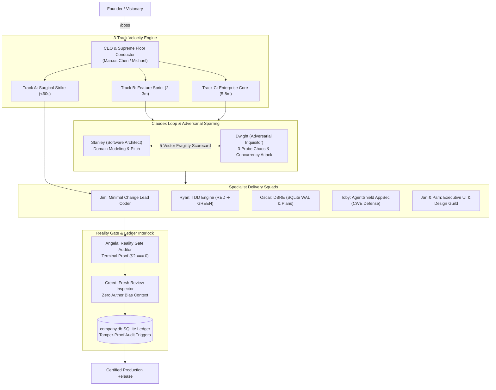

# 🏢 The Boring Company — Autonomous AI Software Enterprise OS

> **"Build and operate software as a production engineering system, not a code generation tool."**

An enterprise-grade, multi-agent operating system and runtime framework designed to coordinate, dispatch, verify, and govern autonomous AI agents working as a real software company.

Developed by **[Abdullah Hanjra](https://www.linkedin.com/in/abdullahhanjracodes/)**.

---

## ⚡ Key Highlights

* **67 Specialized Autonomous Agents**: Complete organizational chart including C-Suite (CEO, CPO, CTO, VPEng, VPOps, VPProd, CRO), Engineering Squads, Adversarial Inquisitors, DBREs, Security Sentinels, and UX Psychologists.
* **3-Track Velocity Engine**:
  * **Track A (Surgical Strike — < 60s)**: Bug fixes, 1-file tweaks, minimal change coder with Karpathy 50-line razor.
  * **Track B (Feature Sprint — 2-3m)**: Software Architect pitches approach, Adversarial Inquisitor runs 3-probe stress test, TDD engine authors failing test before code.
  * **Track C (Enterprise Core — 5-8m)**: Architecture Decision Records (ADRs), AppSec threat modeling, database migration reliability, and 14-point UI finish gate.
* **Actor-Based Hive IPC Protocol**: Single-writer file-based message queues (`inbox/`, `outbox/`, `.done/`) and socket hooks (`agy-hook.cjs`, `hive-proxy.cjs`) communicating with native processes.
* **Relational Operating Ledger (SQLite)**: 45+ tables managing companies, departments, positions, teams, employees, tasks, executions, token budgets, and tamper-proof governance audit events.
* **The Reality Gate Interlock**: No mission is marked complete without attached machine proof (`$? === 0`) and multi-stage verification.
* **Over 400 KB Institutional Memory**: Deep memory store including `anti-patterns.md`, `10X_DECISION_ENGINE.md`, `MASTER_AGENT_DNA.md`, and semantic vector memory via ChromaDB.

---

## 🏛️ System Architecture



---

## 📂 Repository Layout

```
theboringcompany/
├── agents/
│   ├── definitions/        # 67 specialist agent markdown configurations
│   ├── roster.json         # Complete organizational roster and station mapping
│   └── MASTER_AGENT_DNA.md # Core operational laws and agent reasoning principles
├── hive/
│   ├── bin/
│   │   ├── agy-hook.cjs    # Socket IPC bridge for agent tool interceptors
│   │   ├── cth-hook.cjs    # Hook handler for Claude harness
│   │   ├── hive-node.cmd   # Windows node executable shim
│   │   └── hive-proxy.cjs  # Streaming reverse proxy with token budget throttling
│   ├── PROTOCOL.md         # File-based single-writer actor communication protocol
│   ├── COMMANDS.md         # Full fleet orchestration command reference
│   └── registry.json       # Live fleet tracking registry
├── database/
│   └── schema.sql          # Enterprise relational SQLite DDL & triggers
├── memory/
│   ├── anti-patterns.md    # 126 KB of historical failure modes & guardrails
│   ├── learnings.md        # 250+ KB of verified empirical engineering solutions
│   ├── 10X_DECISION_ENGINE.md
│   ├── FOUNDER_LEARNING_ENGINE.md
│   └── MEETING_SYSTEM.md   # Autonomous cross-agent synchronous meeting protocol
└── scripts/
    ├── train-agents.js     # Tool synchronization & Rule 16/17 certification
    └── design-mcp-server.js
```

---

## 🚦 The 6 Founder Headache-Killers

Every task executed within the company strictly complies with these guarantees:

1. **Zero Regressions Guarantee**: Every file touch is backed by automated regression tests. We never break existing features when adding new ones.
2. **Chaos-Hardened Reliability**: Double-click idempotency, network timeouts, graceful async fallbacks, and zero unhandled crashes.
3. **Sub-100ms Speed & Zero Bloat**: Native Node/web APIs first, zero N+1 database queries, indexed tables, and zero bloated packages.
4. **Executive 1-Minute Clarity Card**: Every completed task delivers a 3-bullet plain-English summary, clickable file links, and uncut terminal test proof.
5. **Hard Token Budget Caps**: Maximum 3 surgical iterations before 4-Option Triage halts and isolates. No infinite loops; zero wasted tokens.
6. **"Boring Code" Maintainability**: Clear, obvious, well-typed code that any human engineer can understand 6 months from now without documentation.

---

## 🛠️ Getting Started

### Prerequisites

* Node.js v18+ (tested on v22)
* Python 3.10+
* SQLite 3

### Installation

```bash
git clone https://github.com/youtubrabdullah1626/theboringcompany.git
cd theboringcompany
npm install
```

### Syncing & Training Agents

Train and equip all 67 agents with their respective MCP server configurations:

```bash
node scripts/train-agents.js
```

---

## 📜 License

MIT License. Copyright (c) 2026 Abdullah Hanjra. See [LICENSE](LICENSE) for details.

---

## 👤 Author

* **Abdullah Hanjra** — Software Builder
* **LinkedIn**: [linkedin.com/in/abdullahhanjracodes](https://www.linkedin.com/in/abdullahhanjracodes/)
* **Portfolio**: [abdullahhanjra.me](http://localhost:3000/)
