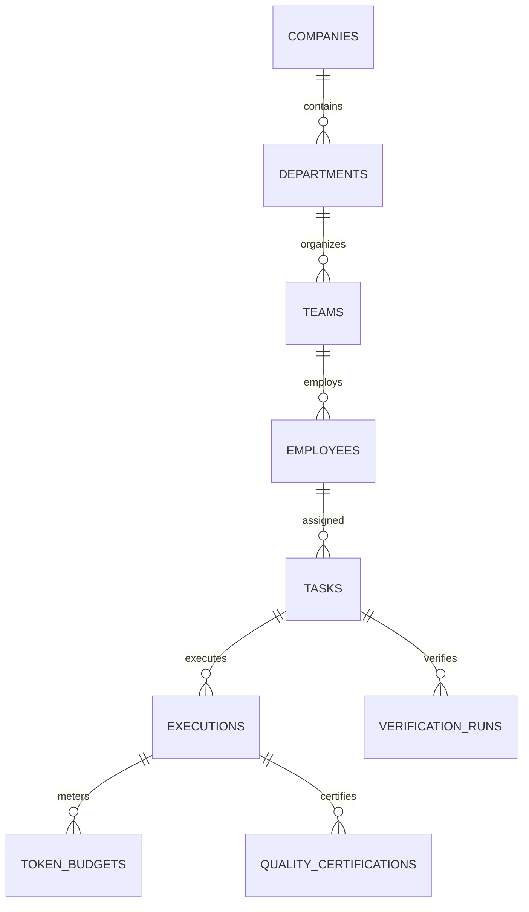

# 🏛️ Architecture & System Design

The Asas Company OS is an autonomous software engineering operating system. It translates high-level founder objectives into verified, production-ready code through a distributed multi-agent hierarchy governed by an immutable SQLite ledger and a strict Reality Gate verification protocol.

---

## 🔄 The 6-Phase Engineering Loop

Every engineering mission executed by The Asas Company OS passes through a deterministic 6-phase lifecycle:

```
ALIGN & CLASSIFY ➔ RECON & MODEL ➔ PLAN & GATE ➔ EXECUTE & OBSERVE ➔ VERIFY & PROVE ➔ COMPLETE
```

### 1. ALIGN & CLASSIFY
- Ingests the mission statement or bug report.
- The **CPO Requirement Engine** decomposes ambiguous goals into unambiguous acceptance criteria.
- Assigns the task to one of three **Velocity Tracks**:
  - **Track A (Surgical Strike, <60s)**: Direct 1-to-3 line bug fixes, typos, config adjustments.
  - **Track B (Feature Sprint, 2-3m)**: Focused module development, new API endpoints, localized refactors.
  - **Track C (Enterprise Core, 5-8m)**: Cross-cutting architectural changes, schema migrations, distributed state handling.

### 2. RECON & MODEL
- Agents inspect the repository before modifying a single line.
- Entry points, call hierarchies, AST signatures, and state mutations are mapped.
- Zero speculative guessing: missing code paths are explicitly flagged as `[UNVERIFIED IN REPOSITORY]`.

### 3. PLAN & GATE (Claudex Loop)
- **Software Architect (Stanley)** drafts a 5-bullet Smallest Justified Design.
- **Adversarial Inquisitor (Dwight)** conducts a 3-probe stress test:
  1. *Concurrency / Race Condition Attack*: What happens under high contention?
  2. *Blast Radius Probe*: Does this change bleed outside the bounded context?
  3. *Failure Recovery Probe*: How does the system behave if external dependencies crash?
- The design must score $\le 2/10$ on the Fragility Index to clear this gate.

### 4. EXECUTE & OBSERVE
- Specialists (Lead Coder Jim, TDD Ryan, DBRE Oscar, AppSec Toby) implement the bounded diff.
- Code is applied in small, coherent units with zero orthogonal drift.
- Standard output and error streams are continuously observed.

### 5. VERIFY & PROVE (The Reality Gate)
- Native test runners execute the automated verification matrix.
- Exit code must be strictly zero (`$? === 0`).
- If a test fails, the agent triggers the **4-Option Diagnostic Triage**:
  1. *Pivot Hypothesis*: Re-evaluate assumptions.
  2. *Revert to Clean Snapshot*: Discard dirty workspace state.
  3. *Isolate in Scratch Reproduction*: Replicate bug in isolation.
  4. *Escalate*: Halt execution and escalate to supervisory conductor.

### 6. COMPLETE
- Produces the **Executive 1-Minute Clarity Card**.
- Commits execution leases and metrics into the SQLite operating ledger.

---

## 🗄️ Relational Operating Ledger (`company.db`)

The company state is backed by an enterprise relational schema (`database/schema.sql`) with 45+ tables and automated triggers:



### Key Schema Highlights
- **Execution Leases**: Prevents multiple agents from modifying the same file or task concurrently.
- **Tamper-Proof Audit Triggers**: SQLite triggers log every state transition into an append-only audit trail.
- **Token Quota Ledgers**: Tracks token usage per agent, per task, and per department.

---

## 📬 Hive IPC & Single-Writer Actor Mailboxes

Agents communicate asynchronously through actor mailboxes:
- Each agent maintains isolated file queues: `inbox/`, `outbox/`, and `.done/`.
- Single-writer guarantees eliminate lock contention and race conditions.
- Socket shims (`agy-hook.cjs`, `hive-proxy.cjs`) provide real-time notification hooks.

### Token Circuit Breakers
The Hive proxy intercepts LLM API calls and applies a 3-tier throttle to prevent runaway loops:
- **`steer` (75% budget)**: Inject system guidance prompting the agent to wrap up open operations.
- **`constrain` (90% budget)**: Revoke code creation tools; allow only read and test commands.
- **`stop` (100% budget)**: Immediately terminate execution, log error, and escalate to supervisor.
