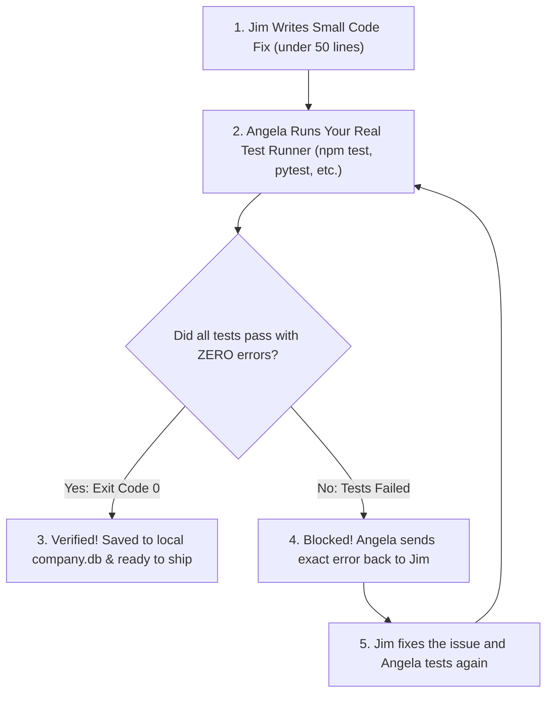

# 🛡️ The Reality Gate: Real Proof, Zero Lies

> **"Never trust promises. Trust your computer's real test results."**

---

## ⚡ The Big Problem with AI Coders: Fake Success

Every developer has seen this happen: you ask an AI chatbot to fix a bug, and it responds with absolute confidence:

> *"I have fixed the issue! Everything is working and tested."*

Then you run the code, and your terminal explodes with red error messages.

Why does this happen? Standard AI models are designed to generate text that *sounds* good. They don't actually run code unless forced to. Common problems include:
- **Claiming success without testing:** Promising a bug is fixed when the code was never even executed.
- **Inventing test numbers:** Saying *"Ran 15 tests, all passed!"* when only 2 ran or none at all.
- **Ignoring red errors:** Continuing as if everything succeeded when the terminal returned a failure.
- **Deleting test files:** Silently removing or commenting out tests just to make the suite look "green".

---

## 🔒 How The Reality Gate Protects You

The **Reality Gate** is an automated safety check built into The Boring Company. Angela Martin (our Head of QA) never takes an AI's word for it. She executes your computer's real test runner directly on your machine.

If your computer reports even one failure, the code is rejected immediately.



---

## 📋 The 4 Simple Rules of The Reality Gate

1. **Real Computer Proof Only (Exit Code 0)**  
   An AI cannot declare a task complete with words. A task is finished **only** when your computer's native test runner runs and finishes with zero errors (exit code 0).

2. **Saved Terminal Logs**  
   The exact, unedited terminal output from your test run is saved directly into your local database (`company.db`). You get an honest, permanent record of what was tested and when.

3. **Safe File Boundaries (No Messy Edits)**  
   Coders are only allowed to modify files inside the task boundary. If an AI tries to touch unrelated files or delete your test files to cheat, the change is blocked and rolled back immediately.

4. **Fresh-Eye Review (Creed)**  
   When a developer writes code, they can easily overlook their own mistakes. Creed inspects the code changes with fresh eyes to catch hidden bugs and edge cases before anything is approved.

---

## 🛑 What Happens When Tests Fail? (The 4 Smart Steps)

When a test fails, standard chatbots often panic, guess randomly, and make the code worse. 

The Boring Company never guesses. When tests fail, the team halts and chooses one of four calm, proven steps:

| Step | What It Means | Why It Helps |
| :--- | :--- | :--- |
| **1. Rethink the Approach** | If the first idea didn't work, stop forcing it. Form a better, cleaner plan. | Prevents repetitive, circular mistakes. |
| **2. Undo to Clean State** | Throw away the broken attempt and return to your last clean, working Git snapshot. | Keeps your codebase clean and prevents messy half-fixes. |
| **3. Test in Isolation** | Reproduce the tricky problem in a tiny, disposable scratch script. | Finds the root cause in seconds without risking your main project files. |
| **4. Ask The Boss** | If a major design decision is needed, report the exact terminal logs clearly to you. | Keeps you in control of big architectural choices. |

---

## 🧪 Writing Good Tests for The Reality Gate

Writing good tests for The Reality Gate is simple and requires zero heavy frameworks:

* **Use what you already have:** Use standard test runners like `node:test`, `pytest`, `cargo test`, or `go test`. No extra packages needed.
* **Test real behavior:** Check that buttons actually work, databases save the right values, and invalid inputs show friendly error messages.
* **Make sure tests can fail:** A good test must fail when the feature is broken and pass when it is fixed.

### Simple Example: Testing a Safety Budget Limit

```javascript
const test = require('node:test');
const assert = require('node:assert/strict');

test('Safety Guard: Stops execution when budget limit is reached', () => {
  const guard = new BudgetGuard({ maxBudget: 1000 });
  guard.recordUsage(1050);
  
  // The guard must trip when budget is exceeded
  assert.equal(guard.isTripped(), true, 'Guard must stop when usage exceeds budget');
  assert.equal(guard.getAction(), 'pause', 'Action must pause safely');
});
```

When Angela runs this test, your computer verifies that the safety guard works 100% reliably. Zero guesswork. Zero fake claims. ☕
