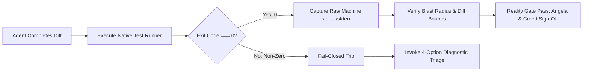

# 🛡️ The Reality Gate Verification Engine

> **"Evidence before confidence. Machine reality overrules narrative claims."**

---

## ⚡ The Core Problem with Autonomous Agents

Large Language Models (LLMs) are statistical generators trained to produce plausible text. When an LLM executes a complex software task, it suffers from a well-documented failure mode: **hallucinated success**.

Common agent failure patterns include:
- Claiming a bug is fixed when tests were never run.
- Fabricating passing assertion counts (e.g. *"Ran 14 tests, all passed"* when only 2 ran).
- Ignoring non-zero shell exit codes (`1`, `127`, `SIGSEGV`) and proceeding as if the task succeeded.
- Silently mutating code outside the stated task boundary to artificially make tests pass.

---

## 🔒 How the Reality Gate Works

The **Reality Gate** is an automated, fail-closed interlock built directly into the operating system of The Boring Company.



### The 4 Pillars of the Reality Gate

1. **Strict Machine Grounding**: An agent cannot declare a task complete using prose. Task completion is unlocked **only** when the native test runner process exits with clean machine status (`$? === 0`).
2. **Raw Output Capture**: The exact, unmanipulated terminal stdout and stderr streams are hashed and recorded into the SQLite `verification_runs` table.
3. **Blast Radius Check**: The diff is checked against the approved task boundary. If the agent modified files outside its bounded context, the gate trips.
4. **Independent Fresh Review (Creed)**: An isolated reviewer agent with zero author context evaluates the diff to catch blind spots and regression risks.

---

## 🛑 The 4-Option Diagnostic Triage

When the Reality Gate trips (exit code $\ne 0$), the agent is strictly prohibited from blindly modifying code in a panic loop. It must halt and select one of four deterministic recovery actions:

```
┌─────────────────────────────────────────────────────────────┐
│              4-OPTION DIAGNOSTIC TRIAGE MATRIX              │
├──────────────────────────┬──────────────────────────────────┤
│ 1. Pivot Hypothesis      │ Invalidate core assumption;      │
│                          │ formulate new diagnostic theory  │
├──────────────────────────┼──────────────────────────────────┤
│ 2. Revert to Snapshot    │ Discard dirty workspace state;   │
│                          │ return to known clean baseline   │
├──────────────────────────┼──────────────────────────────────┤
│ 3. Scratch Reproduction │ Isolate minimal failing case in  │
│                          │ disposable scratch script        │
├──────────────────────────┼──────────────────────────────────┤
│ 4. Conductor Escalation  │ Escalate failure with raw logs   │
│                          │ to CEO / Lead Director           │
└──────────────────────────┴──────────────────────────────────┘
```

---

## 🧪 Writing Reality Gate Tests

Reality Gate test suites must follow these standards:
- **Zero Third-Party Runtime Bloat**: Prefer native test runners (`node:test`, standard pytest, or go test).
- **Fail-Closed Assertions**: Tests must fail if any invariant is violated.
- **Deterministic**: Tests must not depend on non-deterministic network requests or unseeded randomness.

**Example Native Test:**
```javascript
const test = require('node:test');
const assert = require('node:assert/strict');

test('Security Gate: Token circuit breaker halts execution at budget cap', () => {
  const governor = new TokenGovernor({ maxTokens: 10000 });
  governor.recordUsage(10050);
  
  assert.equal(governor.isTripped(), true, 'Governor must trip when usage exceeds cap');
  assert.equal(governor.getCurrentAction(), 'stop');
});
```
